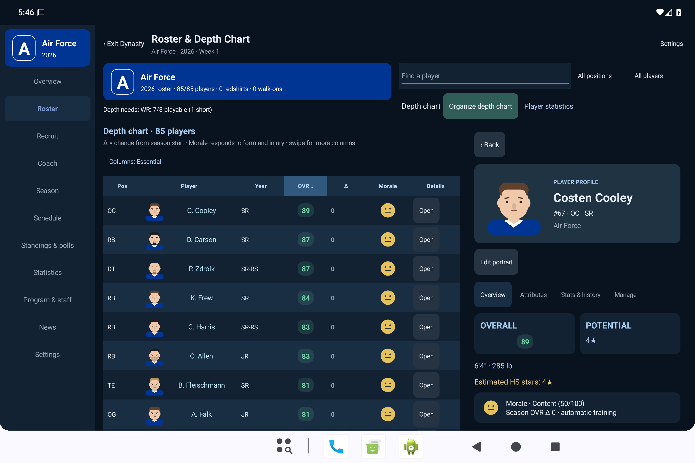
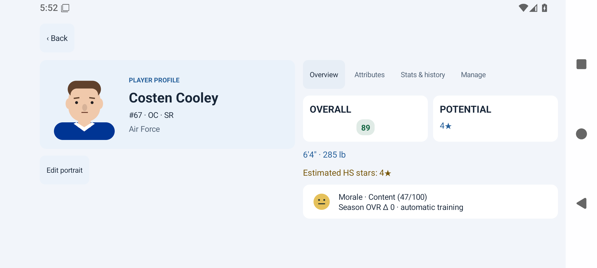

# Management UI Phases 1–2 — Build 306

Validated 2026-10-23. Application source: `d41060a`, branch `feature/management-ui-overhaul`. Later commits contain documentation only.

- [Download test APK](https://github.com/antdroidx/Football-Sim-Engine/actions/runs/39996702027/artifacts/12521215150)
- [Passing build and device checks](https://github.com/antdroidx/Football-Sim-Engine/actions/runs/39996702027)
- [Complete screenshot/XML evidence](https://github.com/antdroidx/Football-Sim-Engine/actions/runs/39996702027/artifacts/12519904680)
- [Review PR 20](https://github.com/antdroidx/Football-Sim-Engine/pull/20) — no merge performed.

## Delivered

The existing .NET MAUI framework remains in place. The shared management shell supports compact bottom tabs and expandable navigation, a persistent wider sidebar, and responsive panels. Dark, Light and System appearance share navy/off-white surfaces and readable team accents. Seven new contrast cases cover selected and normal surfaces. Native Android bar icons follow appearance. System changes wait for active dynasty processing to commit and defer across modals.

The dashboard connects record, poll rank, next game, injuries, task shortcuts and real headlines to existing screens. Roster browsing has search, position/role filters, numeric sorting, saved Essential/All column presets, horizontal scroll, morale and season deltas. Profiles use existing attributes, physical information, recruiting stars, history/statistics, honors, injuries and management actions. Compact profiles are full screen; wide rosters retain a profile pane; wide modal profiles place identity beside details.

Recruiting uses a compact sortable table and overview/recruitment profiles, with existing phase-aware actions, board and priority-scout shortcuts. Compact profiles hide hub controls. Actual scouted ranges and revealed priorities remain authoritative; hidden potential is not exposed. Existing deterministic cartoon portraits and imported appearance are reused. Initial-letter school marks use existing team colors; no Football Manager graphics, real team logos or photographs were added.

## Verification

| Check | Result |
| --- | --- |
| Core/data regressions, including seven new contrast cases | 641 passed |
| Android UI synchronization helpers | 9 passed |
| Android compile and signed APK | Passed; six pre-existing warnings |
| Packaged resources | Passed |
| Compact 360 dp, foldable-size 700 dp, tablet 1200 dp windows | Passed |
| Sort direction and Essential/All columns | Passed |
| Player attributes and recruit actions/profile navigation | Passed |
| Both tablet profile panes | Passed |
| Dark/Light/System, OS appearance changes and live-state retention | Passed |
| Light profile rotated to short landscape, morale visible | Passed |
| OS theme changed immediately after starting week advancement | Passed; completed week retained |
| Game Day entry, overlays, rotation, stats, timeouts, replays and Watch | Passed |
| Cancel Skip; confirm Skip; inspect final stats; Close | Passed without crash |
| Week progression, depth Auto Set, recruiting, departures and Hall of Fame | Passed |

The normal core command excludes the separate expensive `DynastyHealthTests` and `OvrCalibrationDynastyTests`. Long-term rating balance was not rerun for presentation changes. Two existing random-identity fixtures were made reproducible with fixed IDs; their original assertions remain. No production generation, progression or rating formulas were changed.

## Screenshots from this APK

| View | Evidence |
| --- | --- |
| Compact dashboard | [Screenshot](compact-dashboard.png) |
| Compact roster | [Screenshot](compact-roster.png) |
| Compact recruit profile | [Screenshot](compact-recruit.png) |
| Tablet roster and player pane | [Screenshot](tablet-roster.png) |
| Tablet recruiting and prospect pane | [Screenshot](tablet-recruit.png) |
| Light landscape player profile | [Screenshot](light-landscape-profile.png) |
| System Light and native bar contrast | [Screenshot](system-light.png) |

## Boundaries and practical limits

Production Core simulation, player generation, rating calculations, save models/persistence, Android package identity/signing and Game Day visualization/playcalling source are unchanged from UI branch base `1dd2b72`. The included Skip/Close orchestration fixes were inherited from that base and are now device-validated. APK updates use the existing development package/certificate.

Recruiting retains cancellable background preparation, yields during view construction, and an 80-row native rendering bound. Search/filter and the existing global sort picker operate on the database; table headers sort the rendered slice. No loading-speed benchmark or full virtualization claim is made.

Window sizes and rotations were verified on an Android 36 emulator at fixed startup density. Physical fold hinges, cutouts, unusually large accessibility font settings and a broad device matrix remain device-testing work. Phases 3–5 (individual staff/team/development, league-information/history/news screens, and final settings/accessibility polish) remain future work. They inherit shared styling but are not claimed as individually redesigned here.

Architecture audit: [management-ui-architecture.md](../../management-ui-architecture.md).
